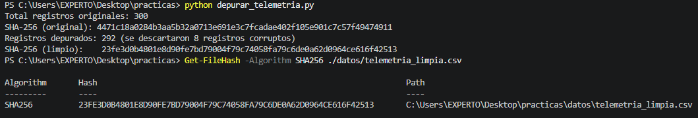
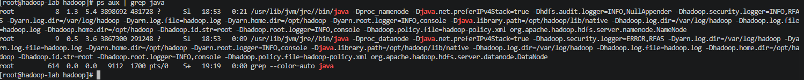
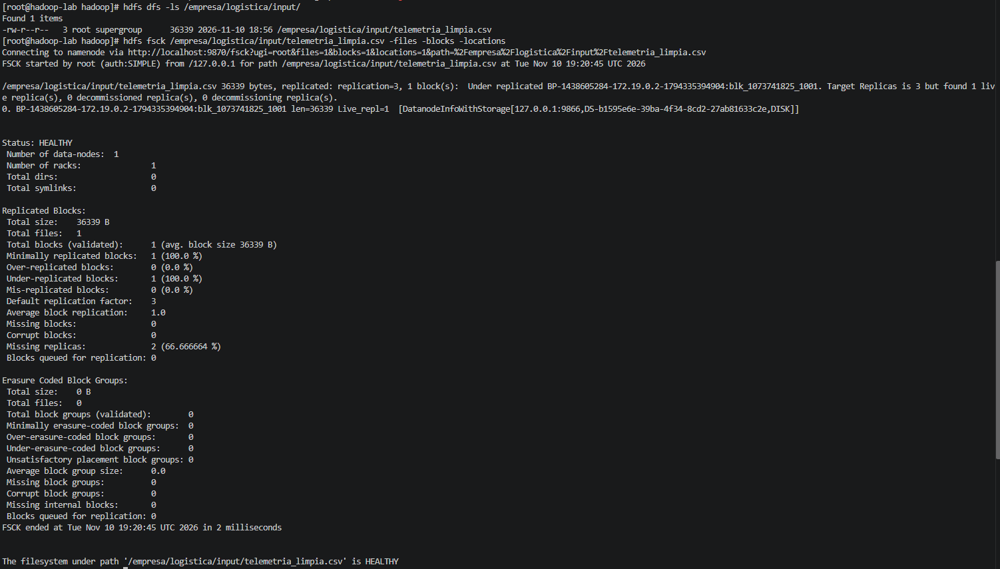
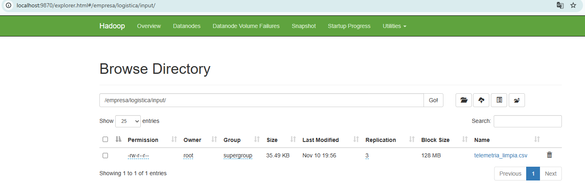

# Práctica Formativa Integradora - Consolidación de Almacenamiento, Integridad del Dato y HDFS

---

## Sección 1 (Integridad - Módulo 5075)

### 1.1. Registro Comparativo de Hashes SHA-256
Asegurando la estabilidad de la información y auditar la transformación del conjunto de datos en origen, calculamos la firma criptográfica **SHA-256** 
antes y después del proceso de saneamiento ->

| Fichero | Registros | Estado | Referencia Criptográfica SHA-256 |
| :--- | :---: | :---: | :--- |
| `telemetria_envios.csv` | 300 | Original (Crudo) | `4471c18a0284b3aa5b32a0713e691e3c7fcadae402f105e901c7c57f49474911` |
| `telemetria_limpia.csv` | 292 | Depurado (Saneado) | `23FE3D0B4801E8D90FE7BD79004F79C74058FA79C6DE0A62D0964CE616F42513` |

### 1.2. Justificación Saneamiento
La divergencia completa entre ambas firmas SHA-256 muestra claramente el **efecto avalancha** propio de las funciones resumen criptográficas ante cualquier modificación al nivel de byte. Ejecutado el script [`scripts/saneamiento.py`](scripts/saneamiento.py) con Pandas depuramos **8 registros corruptos**:

* **Valores nulos (3 registros):** Ausencia de datos críticos en `temp_celsius` (`ENV-2026-1015`), `peso_kg` (`ENV-2026-1067`) y `destino` (`ENV-2026-1189`).
* **Registros duplicados (2 registros):** Filas idénticas correspondientes a retransmisiones de sensores (`ENV-2026-1012` y `ENV-2026-1078`).
* **Inconsistencia física (1 registro):** Peso neto negativo (`ENV-2026-1088`: `-45.5 kg`).
* **Anomalía térmica / Outlier (1 registro):** Temperatura fuera de rango operativo (`ENV-2026-1142`: `98.4 °C`).
* **Error de estado (1 registro):** Etiqueta de sistema no válida (`ENV-2026-1210`: `DESCONOCIDO_ERROR`).

---

## Sección 2 (Despliegue y HDFS - Módulo 5074)

### 2.1. Arquitectura Contenedor y Puertos Mapeados
El clúster pseudodistribuido se desplegó mediante Docker Compose utilizando la imagen oficial `apache/hadoop:3.4.0` (`container_name: hadoop-lab`), montando el volumen local `./datos:/workspace` y mostrando los siguientes puertos hacia el equipo anfitrión:

* **Puerto `9870:9870`:** Interfaz web de administración y monitorización del **NameNode** (`http://localhost:9870`).
* **Puerto `8088:8088`:** Interfaz web del gestor de recursos **YARN ResourceManager**.

### 2.2. Comandos HDFS Ejecutados y Auditoría de Bloques

Comandos del terminal con el que ejecutamos ciclo de ingestión y la auditoría física:

> **Nota técnica (`ps aux` vs. `jps`):** La herramienta `jps` se distribuye únicamente dentro del kit de desarrollo completo (**JDK**). Ya que la imagen oficial `apache/hadoop:3.4.0` emplea un entorno de ejecución más ligero (**JRE**) para minimizar el tamaño del contenedor, pues he utilizado el comando nativo de Linux `ps aux | grep java` para inspeccionar directamente la tabla de procesos del sistema y verificar los argumentos de arranque de los demonios


```bash
# Creación jerarquía de directorios HDFS
hdfs dfs -mkdir -p /empresa/logistica/input

# Ingesta del dataset ya saneado desde el volumen montado
hdfs dfs -put /workspace/telemetria_limpia.csv /empresa/logistica/input/

# Verificar metadatos, permisos y contenido
hdfs dfs -ls /empresa/logistica/input/
hdfs dfs -head /empresa/logistica/input/telemetria_limpia.csv

# Auditoría de integridad y la localización física de bloques
hdfs fsck /empresa/logistica/input/telemetria_limpia.csv -files -blocks -locations
```

---

## 3. Análisis Crítico: Tolerancia a Fallos e Integridad en HDFS

Sabiendo que un fichero en HDFS no se pierde cuando se apaga o falla un DataNode porque el sistema trabaja con **replicación de bloques**. Cuando subimos un archivo a HDFS, este se divide en bloques y, por defecto, se guardan **3 copias exactas** de cada bloque repartidas en distintos DataNodes del clúster (incluso en diferentes racks o bastidores físicos). Así, si uno de los servidores se apaga de repente, los datos siguen estando disponibles en los otros dos nodos sin interrumpir el acceso al fichero

Además, el clúster tiene la capacidad de recuperarse por sí solo gracias a la comunicación constante entre los nodos. Todos los DataNodes envían cada pocos segundos una señal de estado al NameNode para confirmar que siguen funcionando, si uno deja de enviar estas señales durante un tiempo determinado, el NameNode lo da por caído, comprueba qué bloques almacenaba ese nodo y automáticamente ordena a los DataNodes que siguen activos que creen nuevas copias de esos bloques en otros servidores sanos, volviendo así a tener las 3 réplicas de seguridad

Ya por último, el fichero tampoco se puede corromper gracias al uso de **sumas de comprobación. Cada vez que se escribe un bloque en HDFS, el sistema calcula un código de verificación (ej `CRC32`) y lo guarda junto al bloque. Cuando un usuario lee el archivo, o el HDFS realiza revisiones periódicas en segundo plano, vuelve a calcular ese código y lo compara con el original; si detecta que el archivo se ha dañado en el disco duro y los códigos no coinciden, ese bloque corrupto se descarta, y lee el dato desde una de las réplicas ya sanas y sustituye el bloque estropeado por una copia correcta

---

## Sección 4 (Evidencias gráficas)

### 4.1. Cálculo y Validación Cruzada de Firmas SHA-256


### 4.2. Verificación de Demonios Activos en el Contenedor Hadoop


### 4.3. Ingesta en HDFS y Auditoría Física de Bloques (`fsck`)


### 4.4. Inspección Visual en la Interfaz Web del NameNode (`localhost:9870`)


